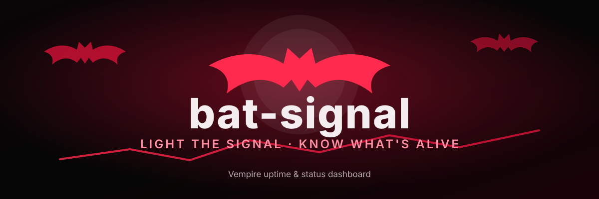

# bat-signal

A dark, Vempire-themed uptime/status dashboard for monitoring URLs from the browser.

## Features

- Add and remove monitored URLs (name + URL), persisted in `localStorage`.
- **Check now** per target and **Check all** for the whole board.
- Status cards with up/down/unknown state, last-checked time, response time in ms, uptime % from stored history, and an inline SVG history sparkline (history capped at 50 points per target).
- Summary header: total targets, up count, down count, and average response time.
- **Demo Mode** toggle that generates realistic simulated up/down/latency data, so the dashboard looks alive with no network calls.
- Vempire theme: black/crimson glass design with bat motifs — no build step, no dependencies.

## Usage

Open `index.html` in a browser (or serve the folder with any static file server, e.g. `python3 -m http.server`), add a target, and hit **Check now**. Flip **Demo Mode** on to explore with simulated data.

## How it works

Targets and their history are stored in `localStorage`. Live checks use the browser `fetch` API with `mode: "no-cors"` and measure elapsed time as the response latency.

**Honest limitation:** browser CORS rules mean a `no-cors` response is *opaque* — JavaScript cannot read the HTTP status code or body. So bat-signal is a **reachability and latency signal** (an opaque response counts as reachable, a rejected fetch counts as down), **not** a full HTTP status check. A page returning HTTP 500 would still look "up" here. For authoritative status monitoring, use a server-side prober. Demo Mode sidesteps the network entirely with simulated results.

The pure logic (`computeUptime`, `summarize`, `sparklinePoints`, `addHistoryPoint`, `probeTarget`, …) is exported from `app.js` and is fully testable in Node; the UI only runs when `document` exists. The fetch function is injectable, so tests mock it instead of touching the network.

## Tests

```bash
node --test
```

Tests cover uptime math, summary aggregation, sparkline point generation, history capping, URL validation, and the mocked fetch probe.

## License

MIT — see [LICENSE](LICENSE). Copyright © 2026 Lavish Gangwar.
